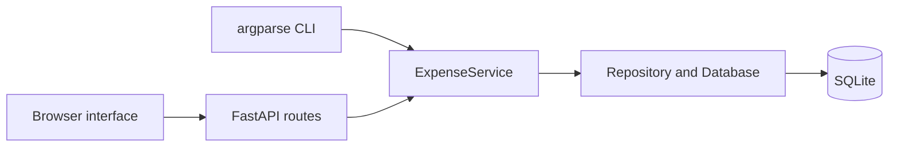
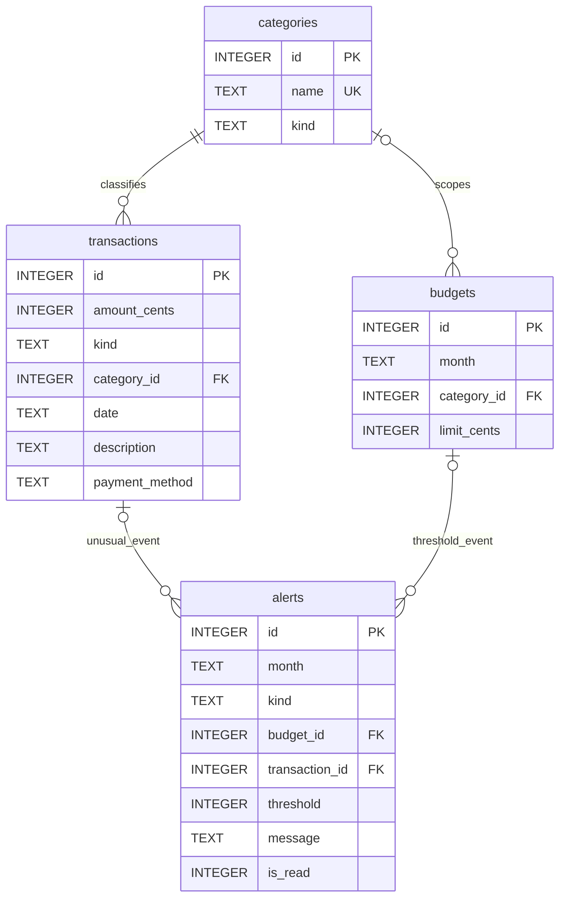

# Application architecture

The frontend is plain HTML, CSS and JavaScript, served by FastAPI on the same origin. No build tools or external CDNs are required to run the interface. Four pages share the same month selection: Overview, Transactions, Budgets and Reports. Forms, alerts and the deterministic assistant are accessible globally.

API schemas reject unknown fields and enforce input types. Shared domain validation also protects direct service calls from the CLI. Amount writes use decimal strings, and stored/read money uses integer cents. Transaction type and category type must agree.

The database module owns connection handling, schema creation, constraints and initial categories. The repository module owns transaction reads and filter queries. ExpenseService coordinates writes, budgets, explainable alerts and reports. Bound SQL parameters protect all caller-provided values.

## Relationships

Category removal is restricted when records reference it. Deleting a transaction removes its anomaly alert. Deleting a budget removes its threshold alerts. The unique month/category scope index also handles an overall budget's null category; a simple nullable composite UNIQUE would allow repeated overall budgets.

## Local demo and normal data

`launch.py --demo` seeds only `data/demo.db` with clearly fictional October 2026 records. It never writes the normal `data/expenses.db`. Repeated demo startup does not reseed a database with existing records. The health endpoint marks demo mode, and the frontend visibly labels it. The default launcher uses the normal database.

## Deliberate limitations

No user authentication, currency conversion, external bank integrations or machine-learning model. The assistant answers a finite set of question types from the selected month's data. Budget and anomaly alerts are saved historical events, while current totals always derive from the ledger.
